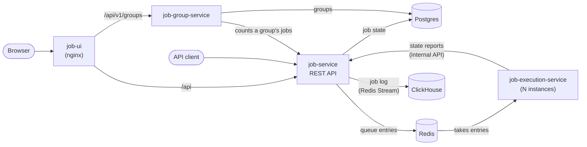

# Job Queue Service

A distributed background job system: clients submit jobs (email, webhook, aircraft transit report)
through a REST API, workers take them from a Redis queue and run them, Postgres keeps their state,
and a web UI lists, inspects, cancels and retries them and shows transit routes on a map. Jobs can
be grouped and followed as one (the project's answer to the Batch job).

- Design decisions and trade-offs: [DECISIONS.md](DECISIONS.md)
- How AI was used: [AI_USAGE.md](AI_USAGE.md); the chats themselves: [AI_CHAT.md](AI_CHAT.md)

## Run the project

Requirements: Docker with Compose v2. For local development also Node 26 and npm.

```bash
git clone https://github.com/hovorun-art/prisma-photonics-test.git
cd prisma-photonics-test
docker compose up --build --wait
```

| What | URL |
|---|---|
| Web UI | http://localhost:8080 |
| Job API | http://localhost:3000 |
| Job API docs (Swagger, every route with examples) | http://localhost:3000/docs |
| Group API and docs | http://localhost:3002, http://localhost:3002/docs |

- Run several workers: `docker compose up --wait --scale job-execution-service=3`
- Stop and remove everything: `docker compose down -v`
- Settings (ports, timings, failure rates, worker concurrency) are listed with their defaults in
  [.env.example](.env.example); copy it to `.env` to change them.
- Local development, apps on the host with hot reload and the databases in Docker:
  `npm ci && npm run dev`.

## Submit a test job

```bash
# An email job; priority (1-10, higher runs first) and maxAttempts are optional
curl -s -X POST http://localhost:3000/v1/jobs \
  -H 'content-type: application/json' \
  -d '{"type":"email","payload":{"to":"ada@example.com","subject":"Hello","body":"Hi Ada"},"priority":8}'
# {"id":"<uuid>","status":"pending","priority":8,"attempts":0,"maxAttempts":3,...}

# Its status, result or error: within a few seconds "completed" with {"messageId":"<uuid>"}
curl -s http://localhost:3000/v1/jobs/<uuid>
# Its log: every step from submit to finish, from the API and the worker
curl -s http://localhost:3000/v1/jobs/<uuid>/logs
```

The other job types and options:

```bash
# A webhook job (simulated call; about 20% fail, to show retries)
curl -s -X POST http://localhost:3000/v1/jobs -H 'content-type: application/json' \
  -d '{"type":"webhook","payload":{"method":"POST","url":"https://example.com/hook","body":{"event":"signup"}}}'

# An aircraft transit report between two airports a week from now; the UI shows its route on a map
DAY=$(date -u -d '+7 days' +%F 2>/dev/null || date -u -v+7d +%F)   # GNU date, or BSD date on macOS
curl -s -X POST http://localhost:3000/v1/jobs -H 'content-type: application/json' \
  -d "{\"type\":\"flight-transit\",\"payload\":{\"origin\":\"LHR\",\"destination\":\"FRA\",\"departureDate\":\"$DAY\"}}"

# A job scheduled an hour from now (at most 30 days ahead): "scheduled" until then, then it runs
AT=$(date -u -d '+1 hour' +%FT%TZ 2>/dev/null || date -u -v+1H +%FT%TZ)
curl -s -X POST http://localhost:3000/v1/jobs -H 'content-type: application/json' \
  -d "{\"type\":\"email\",\"payload\":{\"to\":\"ada@example.com\",\"subject\":\"Later\",\"body\":\"Hi\"},\"scheduledAt\":\"$AT\"}"

# Safe to send twice: with an idempotencyKey a repeat answers 200 with the job it created (201 the
# first time); the same key with a different request answers 409 IDEMPOTENCY_KEY_CONFLICT
curl -s -i -X POST http://localhost:3000/v1/jobs -H 'content-type: application/json' \
  -d '{"type":"email","idempotencyKey":"order-4821-receipt","payload":{"to":"ada@example.com","subject":"Receipt","body":"Thanks"}}'

# List with filters (repeat a filter for several values)
curl -s 'http://localhost:3000/v1/jobs?status=failed&type=webhook&limit=20'

# Cancel a scheduled, pending or running job; retry a failed one
curl -s -X PATCH http://localhost:3000/v1/jobs/<uuid> -H 'content-type: application/json' -d '{"status":"cancelled"}'
curl -s -X PATCH http://localhost:3000/v1/jobs/<uuid> -H 'content-type: application/json' -d '{"status":"pending"}'

# Health and queue statistics
curl -s http://localhost:3000/health
curl -s http://localhost:3000/v1/stats

# A group: create it, submit its jobs with its id (one request for all), then follow it
curl -s -X POST http://localhost:3002/v1/groups
curl -s -X POST http://localhost:3000/v1/jobs/bulk -H 'content-type: application/json' \
  -d '{"jobs":[{"type":"email","payload":{"to":"ada@example.com","subject":"Hi","body":"1"},"groupId":"<group-id>"},
               {"type":"email","payload":{"to":"alan@example.com","subject":"Hi","body":"2"},"groupId":"<group-id>"}]}'
curl -s http://localhost:3002/v1/groups/<group-id>
```

Every error has the same body: `{"code": "...", "message": "...", "details": {...}}`, with `code`
from a closed list (for example `VALIDATION_FAILED`, `JOB_NOT_FOUND`, `JOB_STATUS_CONFLICT`); the
codes and their HTTP statuses are in the API docs.

## Run the tests

```bash
npm ci
npm test            # unit, integration and per-app e2e tests (needs Docker for Testcontainers)
npm run test:e2e    # the UI in a browser, and the whole compose stack end to end
npm run typecheck && npm run lint
```

- **Unit** tests sit next to the code (`*.test.ts`).
- **Integration** tests (`*.int.test.ts`) run one adapter against a real Postgres, Redis or
  ClickHouse in a container.
- **Per-app e2e** tests (`apps/<app>/test/e2e/`) run one service as a black box with its own
  database; the worker is tested on its own there, with the API it reports to mocked.
- **System e2e** (`tests/system-e2e/`) starts the whole stack with three workers; its last tests
  kill a worker and wipe Redis to show that every job is still recovered and completed.

## Architecture



- **job-service** owns the jobs: the public API, the job table in Postgres (it is the only service
  that touches it) and the queue entries. Each job's log goes through a Redis Stream into
  ClickHouse and is read back through the same API.
- **job-execution-service** is the worker. It takes entries from the queue (BullMQ on Redis), runs
  the job with the handler of its type and reports every state change through job-service's
  internal API; it has no database access. It scales horizontally and runs several jobs at once
  per instance.
- **job-group-service** follows groups of jobs. A group is created empty, the client submits the
  jobs with the group's id, and the service polls job-service to count them and set the group's
  status. It has its own Postgres schema.
- **job-ui** (React) is served by nginx, which routes `/api` to the two APIs. Pages: jobs list,
  job page (with its log and, for transit reports, the map), submit form, groups list, group page
  and new group.
- **Shared packages:** `packages/contracts` holds the Zod schemas for every request, response and
  error, used by the API validation, the API docs and the UI; `packages/kernel` and
  `packages/service-kit` hold the code the services share.

Job lifecycle: `scheduled` → `pending` → `processing` → `completed` or `failed`; a job that has not
finished can be `cancelled`, and a failed one can be retried by hand. A failed attempt with
attempts left is `scheduled` again for its automatic retry, after a growing random delay. How pickup, crash recovery,
priority, retries and duplicates are handled is in [DECISIONS.md](DECISIONS.md).
